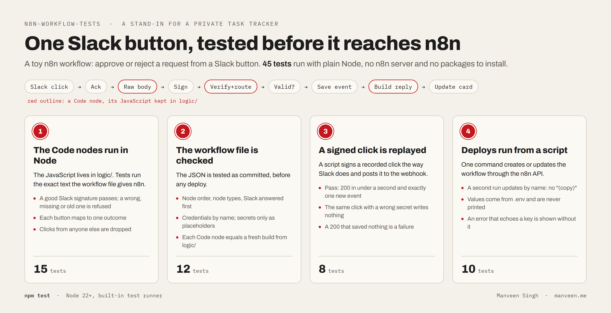

# n8n-workflow-tests

A small n8n workflow with four of the five kinds of test from my own n8n task tracker: the Code-node JavaScript, the workflow file, a replayed Slack click and the deploy, all checked with plain Node.



Node 22+, no packages to install · 45 tests · a stand-in, built in October 2026, for a private repo

## Why this exists

My own task tracker runs on Slack buttons and two n8n workflows, and has 149 automated tests ([how and why](https://manveen.me/writing/149-tests-for-a-few-slack-buttons)). That repo is private. This one rebuilds the same test setup on a toy workflow, so you can read it and run it.

## What the workflow does

A Slack message has Approve and Reject buttons. When someone clicks one, n8n:

1. answers Slack at once (Slack allows 3 seconds),
2. checks the request came from Slack: an HMAC signature of the raw body, sent no more than five minutes ago,
3. accepts clicks from one allowed user only,
4. saves one event (`approved` or `rejected`) to an events API,
5. updates the Slack card to `Request req-42 approved by <@U0ALLOWED>.`

## How it is tested

| | What is checked | Tests |
|---|---|---|
| 1 | **Code nodes run in Node.** The JavaScript lives in `logic/`; tests run the exact text the workflow file gives n8n. | 15 |
| 2 | **The workflow file, as committed.** Node order and types, Slack answered first, credentials by name, secrets only as placeholders, and each Code node equal to a fresh build from `logic/`. | 12 |
| 3 | **A signed click, replayed.** Pass: 200 in under a second and exactly one new event. The same click signed with a wrong secret must write nothing. | 8 |
| 4 | **Deploys from a script.** A second run updates the workflow by name instead of making a copy. Values from `.env` are never printed, even when an error echoes them back. | 10 |

The replay tests post to a local server that answers first and then runs the committed workflow node by node (`test/helpers/run_workflow.mjs`), so no n8n server is needed.

## Run it

```
npm test          # all 45 tests
npm run check     # the workflow file matches logic/
```

Against your own n8n, copy `.env.example` to `.env` and fill in `N8N_URL`, `N8N_API_KEY`, `SLACK_SIGNING_SECRET`, `ALLOWED_USER`, `EVENTS_URL` and `EVENTS_CRED_ID` (the id of an n8n Header Auth credential named "Events API"). Then:

```
npm run deploy -- --dry-run    # what would be sent, values shown as <NAME from .env>
npm run deploy                 # create or update "Approve click", then switch it on in n8n (deploy doesn't)
npm run replay -- --url https://your-n8n.example/webhook/approve-click --events-dir DIR [--fixture FILE] [--bad-sig]
```

## Limits

- A toy: one pair of buttons, one allowed user, no retry if the events API is down.
- The tests don't run n8n itself: `test/helpers/` stands in for the six node types the workflow uses. On 9 Nov 2026 it also ran in a real n8n (2.46.6, local): a signed click wrote one event, a wrong signature and a click from another user wrote none, and a second deploy updated it by name.
- `--events-dir` needs your events endpoint to write one file per event into a folder the script can read.
- The deploy puts the signing secret into the Sign node's settings, so anyone who can edit the workflow in n8n can read it.

Built by [Manveen Singh](https://manveen.me). MIT licence (see LICENSE).
